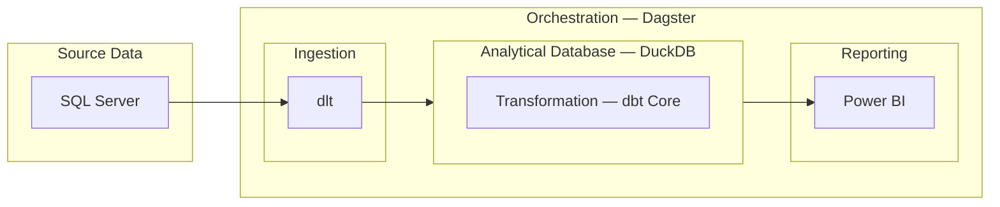

# Modern Data Stack

## 1. What is a modern data stack, and what are its components?

A **modern data stack (MDS)** is a collection of integrated tools and technologies that support data collection, ingestion, storage, cleaning, transformation, analysis, and governance. These tools can run in the cloud or locally, as in this DuckDB-based project.

### 1.1. Data storage

Data storage is the foundation of the MDS. It provides a centralized environment for managing structured and unstructured data. Storage technologies should be selected according to cost, performance, and scalability requirements.

Common types of data storage include:

- **Data warehouses:** Consolidate structured data from multiple sources into a central store optimized for analytics, AI, and ML. Examples include Snowflake, Google BigQuery, and Amazon Redshift.
- **Data lakes:** Store raw structured and unstructured data in various formats, often at petabyte scale or beyond, for analytics, AI, ML, and research. Many early data lakes used Hadoop; modern architectures commonly use cloud object storage such as Amazon S3 and IBM Cloud Object Storage.
- **Data lakehouses:** Combine the scalability of data lakes with the structured querying and data-management capabilities of warehouses. They support structured, semi-structured, and unstructured data for BI, analytics, and ML workloads.

### 1.2. Data ingestion

Data ingestion collects and moves data from source systems into centralized storage for processing and analysis.

Common ingestion patterns include:

- **Batch ingestion:** Collects data in groups and loads it at scheduled intervals. It is suitable when continuous updates are unnecessary and can be cost-effective for periodic workloads.
- **Real-time or streaming ingestion:** Continuously ingests incoming data with low latency. It supports use cases such as fraud detection, real-time analytics, and AI applications requiring fresh data. It can require additional compute resources and operational complexity.

### 1.3. Data transformation

Data transformation makes data clean, consistent, structured, and suitable for analytics, reporting, and ML.

Common tasks include:

- **Data cleaning:** Address errors, missing values, and duplicates.
- **Normalization and standardization:** Standardize formats and representations for consistency.
- **Aggregation:** Summarize large datasets for reporting.
- **Merging:** Combine data from multiple sources into a unified dataset.

### 1.4. BI and analytics

BI and analytics turn data into actionable insights through analysis, visualization, trend exploration, SQL queries, and, where appropriate, AI-assisted analysis and automation.

### 1.5. Data observability

Data observability monitors data and pipeline health to support quality, availability, and reliability. It helps teams detect broken pipelines, missing records, stale data, and slow processing before these issues affect downstream analysis.

### 1.6. Data governance

Data governance establishes policies, ownership, and safeguards for security, privacy, regulatory compliance, and consistent data use. It includes managing access, documenting definitions, setting retention rules, and overseeing how data is handled throughout its lifecycle.

### 1.7. ML and AI

Some data platforms integrate ML and AI to support predictive modeling, automate insights, improve processing, and detect anomalies. These capabilities can also help identify workflow inefficiencies and suggest improvements.

## 2. Project architecture and technology selection

### 2.1. Architecture

The project uses **SQL Server** as the source, **dlt** for ingestion, **DuckDB** as the analytical database, **dbt Core with the DuckDB adapter** for transformation, **Dagster** for orchestration, and **Power BI** for reporting.

The arrows represent **data flow**: SQL Server → dlt → DuckDB → Power BI. The outer Dagster box represents orchestration across ingestion and transformation. Refreshing Power BI after the DuckDB models are updated is a separate step.

**dbt Core is shown inside the analytical database box to indicate that transformation happens in DuckDB.** Its process runs externally and submits SQL for DuckDB to execute. dlt and dbt point to the same persistent DuckDB file, and Power BI imports the resulting analytical data through ODBC.

### 2.2. Ingestion — dlt

**dlt is selected for its Python flexibility, reusable connectors, and control over extraction and loading.**

- **Prebuilt sources and destinations:** The `sql_database` source supports SQL Server, and the DuckDB destination loads data into a persistent local database file.
- **Flexible extraction and loading:** Full extraction, cursor-based incremental loading, custom SQL, and `append`, `replace`, or `merge` write dispositions can be configured per resource.
- **Schema management:** Schema inference, evolution, hints, and contracts help accommodate source data while controlling unexpected changes.
- **Validation and inspection:** Pydantic or custom Python validation can enforce expectations; logs, traces, and load information expose ingestion results and failures.
- **Lightweight orchestration integration:** Run Python ingestion alongside Dagster-managed workflows without operating a separate ingestion platform.
- **Privacy and extensibility:** Remove or pseudonymize sensitive fields before loading and implement additional sources in Python.
- **Open-source library:** No library licensing fee; compute, storage, backups, and maintenance still contribute to cost.

| Tool | Main characteristics and features |
| --- | --- |
| **dlt OSS** | Code-first Python library with prebuilt sources/destinations, customizable extraction, schema management, incremental loading, and pipeline inspection. The team manages deployment and operations. |
| **Airbyte** | Connector-based replication platform with a web UI, scheduling, sync monitoring, and connector-dependent CDC. Available as self-managed Core or managed offerings. |
| **Fivetran** | Managed data integration service with prebuilt connectors, automated synchronization, and managed infrastructure. Custom Python connectors can be built using Connector SDK. |

**Important boundary:** Cursor-based incremental extraction is not equivalent to log-based CDC. The standard dlt SQL source does not automatically capture every intermediate update or detect hard-deleted source rows. Duplicate prevention requires suitable keys and write settings.

### 2.3. Analytical database — DuckDB

**DuckDB is selected for file-based analytical storage, local SQL execution, and compatibility with the chosen stack.**

- **Embedded infrastructure:** Runs within the application process and persists analytical tables in a local DuckDB database file. No separate database server is needed.
- **Local compute and storage:** Query performance depends on the host machine, while the database file requires sufficient disk space and backups.
- **Compute controls:** Configure resource use for the host and schedule data loading and transformation jobs to avoid overlapping writes.
- **Access and recovery:** Protect the database file with operating-system permissions and backups; DuckDB does not provide Snowflake-style roles or Time Travel for this project.
- **Stack compatibility:** Supported by the dlt DuckDB destination, the dbt DuckDB adapter, and the DuckDB ODBC driver for Power BI Import.

| Tool | Main characteristics and features |
| --- | --- |
| **DuckDB** | Embedded analytical database suited to local development, file-based analysis, and applications. Core execution uses the resources of the machine or process hosting it. |
| **Snowflake** | Managed cloud analytics platform with virtual warehouses, separated compute/storage, access controls, and Time Travel. Costs include compute and storage. |
| **BigQuery** | Serverless cloud data warehouse with managed execution and Google Cloud integration. Compute can use on-demand or capacity-based pricing. |

DuckDB file size, host resources, and backups should be monitored. In the standard file-backed setup, dlt and dbt should write to the same database sequentially; Power BI refresh should run after both finish. Uniqueness in analytical tables must be verified through ingestion rules and data tests.

### 2.4. Transformation — dbt Core

**dbt Core is selected for maintainable SQL transformations, testing, documentation, and ecosystem compatibility.**

- **Modular and reusable SQL:** Models, `ref()`, Jinja macros, and packages organize staging and marts and reduce duplicated business logic.
- **Flexible materializations:** Use tables, views, and incremental models according to each model's needs. Incremental filters and keys must be configured correctly.
- **Input and output validation:** Built-in and custom data tests can validate source data and transformed models.
- **Documentation and lineage:** Generated documentation and model dependency graphs help explain data definitions and upstream relationships.
- **Dagster integration:** Represent individual dbt models as assets and coordinate transformations with successful ingestion.

| Tool | Main characteristics and features |
| --- | --- |
| **dbt Core** | SQL models, macros/packages, materializations, tests, documentation, and lineage. Scheduling and operational recovery are handled through the surrounding workflow. |
| **SQLMesh** | SQL transformation framework with change planning, processed-interval tracking, targeted backfills, and virtual environments. Requires persistent state management. |
| **Dataform** | SQLX workflows, assertions, documentation, Git integration, and managed execution for BigQuery. It does not meet this project's DuckDB requirement. |

Keep shared business definitions in documented DuckDB models where practical. Use Power BI measures for report-specific calculations without independently redefining the same KPI in multiple places.

### 2.5. Orchestration — Dagster

**Dagster is selected for asset-oriented orchestration and visibility across the dlt/dbt workflow.**

- **Asset-based dependencies:** Describe the tables and other data products that need to be created or updated and how they depend on one another.
- **Native dlt and dbt integrations:** Coordinate ingestion and transformation with visibility into individual dbt models.
- **Execution visibility:** Inspect materializations, logs, failures, run history, and recorded metadata.
- **Partitions and backfills:** Reprocess selected dates or partitions when historical data is missing or model logic changes.
- **Testable Python workflows:** Test individual computations with supplied inputs and mocked resources before deployment.

| Tool | Main characteristics and features |
| --- | --- |
| **Dagster** | Asset-oriented Python orchestration with dependency graphs, execution metadata, asset checks, and partition-based backfills. |
| **Airflow** | Python DAGs built around tasks, operators, and sensors, with scheduling, retries, and backfills. Also supports asset-aware scheduling. |
| **Kestra** | Declarative YAML flows and visual editing, with plugins, schedule/event triggers, parallel execution, retries, and concurrency controls. |

Declaring an asset dependency alone does not automatically launch new runs. Configure schedules, sensors, or declarative automation and enable the required processes. Coordinate dlt and dbt so their write processes do not overlap on the same DuckDB file. Dagster OSS must be operated on suitable infrastructure; managed Dagster+ features and pricing should be evaluated separately.

### 2.6. Reporting — Power BI

**Power BI is selected for semantic modeling, reusable measures, and interactive business reporting.**

- **Data modeling and DAX:** Define relationships and reusable measures for revenue, profit margin, and customer analysis.
- **Interactive reporting:** Filters, slicers, and drill-downs support analysis by market, segment, and product.
- **DuckDB connectivity:** Use the DuckDB ODBC driver to import analytical data into Power BI Desktop. A published report needs a reachable database file and a configured gateway for refresh.
- **Distribution and access:** Power BI Service supports sharing, scheduled refresh, and row-level security, subject to configuration and licensing.
- **Free development:** Power BI Desktop is free. Private sharing generally requires paid licenses or qualifying capacity.

| Tool | Main characteristics and features |
| --- | --- |
| **Power BI** | Semantic modeling, DAX, Power Query, interactive reports, Microsoft integration, and access controls. Suited to reusable business metrics. |
| **Tableau** | Flexible visual exploration, drag-and-drop analysis, and customizable interactive dashboards. Suited to visual analytics and presentation. |
| **Data Studio** | Browser-based reporting with sharing and connections to Google Sheets, Google Analytics, and BigQuery. Offers a no-cost version and optional Pro features. |

Use Import for this DuckDB ODBC setup. Refresh Power BI after the dlt and dbt jobs complete. For a published Power BI Service report, a gateway with the DuckDB ODBC driver and access to the database file is needed for scheduled refresh; API refresh also requires appropriate authentication and permissions.

