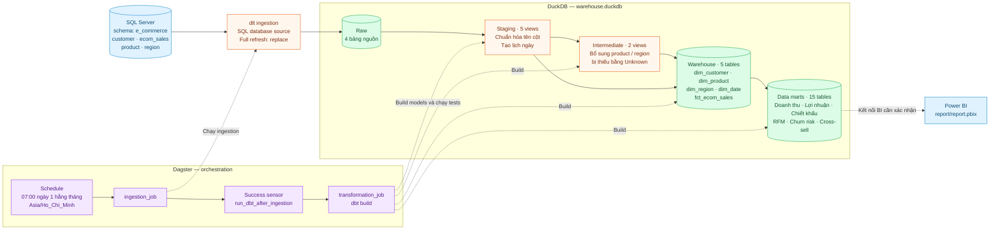
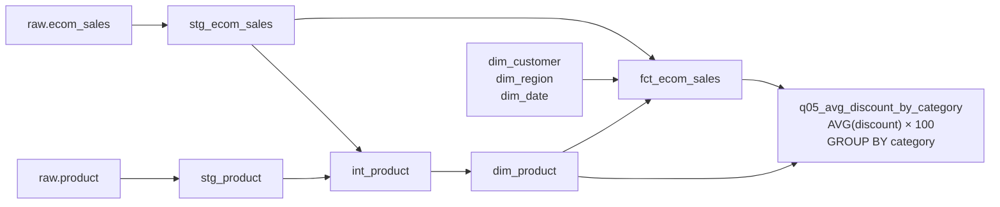

# Data Solution Architecture — E-commerce Analytics

Kiến trúc ELT hiện có trong repository: dlt nạp dữ liệu từ SQL Server vào DuckDB; dbt biến đổi dữ liệu theo các lớp; Dagster điều phối ingestion và transformation.

Mũi tên liền thể hiện luồng dữ liệu hoặc trình tự điều phối trong nhóm Dagster. Mũi tên nét đứt thể hiện lệnh điều phối; riêng đường tới Power BI là kết nối chưa được xác nhận.

## Các thành phần

| Thành phần | Vai trò | Mã nguồn / artifact |
|---|---|---|
| SQL Server | Nguồn dữ liệu `e_commerce`: customer, ecom_sales, product, region | `dbt_model/models/staging/sources.yml`, `ingestion/load_data.py` |
| dlt | Đọc nguồn SQL và nạp lại toàn bộ 4 bảng vào dataset `raw` | `ingestion/load_data.py` |
| DuckDB | Lưu raw và các lớp dữ liệu dbt trong cùng một database; đường dẫn qua `DUCKDB_PATH` | `dbt_model/profiles.yml` |
| dbt staging | 5 views: customer, product, region, sales và lịch ngày được sinh từ dbt_date | `dbt_model/models/staging/` |
| dbt intermediate | 2 views bổ sung bản ghi Unknown cho product / region xuất hiện trong sales nhưng thiếu ở nguồn dimension | `dbt_model/models/intermediate/` |
| dbt warehouse | Star schema gồm 4 dimensions và 1 fact; dimensions sử dụng surrogate keys | `dbt_model/models/warehouse/` |
| dbt marts | 15 bảng phân tích phục vụ các câu hỏi kinh doanh | `dbt_model/models/marts/` |
| Dagster | Lịch ingestion, theo dõi trạng thái thành công và kích hoạt `dbt build` | `orchestration/` |
| Power BI | File báo cáo hiện có; chưa xác nhận nguồn và chế độ refresh của báo cáo | `report/report.pbix` |

## Ví dụ lineage: chiết khấu trung bình theo category

## Ghi chú triển khai

- Đây là batch full refresh: ingestion dùng `write_disposition='replace'`; chưa có cơ chế incremental hoặc CDC trong mã nguồn đã kiểm tra.
- Lịch được khai báo chạy lúc 07:00 ngày 1 mỗi tháng theo giờ Việt Nam. Việc chạy tự động cần schedule, sensor và Dagster daemon được bật trong môi trường triển khai.
- `dbt build` thực thi models và các tests đã khai báo như `not_null`, `unique`, `relationships`.
- Staging và intermediate được materialize thành views; warehouse và marts thành tables. Tên schema vật lý phụ thuộc quy tắc generate schema của dbt; với cấu hình mặc định và target `main`, tên thường là `main_staging`, `main_intermediate`, `main_warehouse`, `main_marts`.
- Lịch ngày hiện sinh từ `2020-01-01` tới `2024-01-01`; fact sử dụng inner joins với dimensions nên độ phủ khóa và ngày ảnh hưởng đến số dòng được giữ lại.
- Sơ đồ mô tả kiến trúc từ mã nguồn, chưa xác minh một deployment đang chạy hoặc kết nối thực tế bên trong file Power BI.
